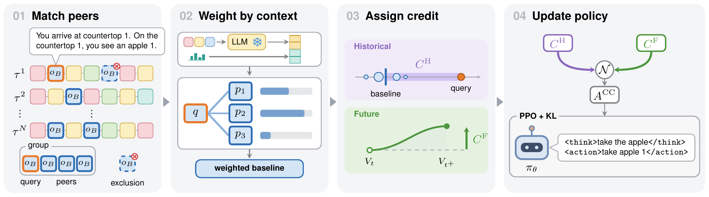
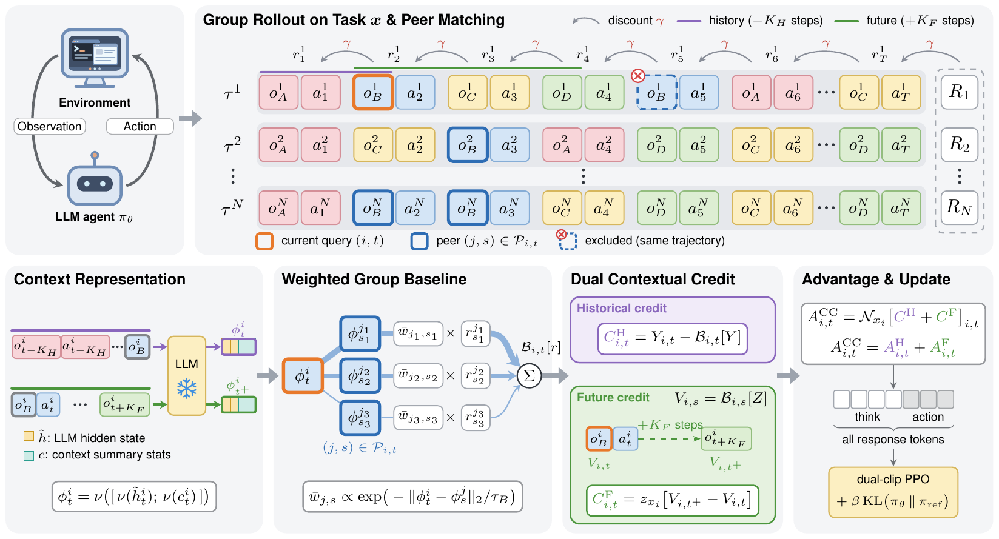

# Contextual Credit Policy Optimization

[Project page](https://agent-ccpo.github.io) | [Paper](https://arxiv.org/abs/2610.19103)

Official implementation of **Contextual Credit Policy Optimization (CCPO)**, a critic-free method that assigns step-level credit to LLM agents trained with group-based reinforcement learning on long-horizon tasks.



*Overview of CCPO. CCPO combines contextually weighted peer comparisons and short-horizon future progress for critic-free step-level credit assignment.*

## Method

CCPO compares each step with observation-matched steps from other trajectories of the same task, and weights these peers by contextual similarity computed from frozen LLM representations and accumulated trajectory statistics. Historical credit compares the realized return with the weighted peer baseline. Future credit measures the change in contextual outcome value over a short realized continuation. Both are computed in hindsight from the collected rollouts, without a value critic.



## Repository structure

| Path | Contents |
|---|---|
| `ccpo/core_ccpo.py` | Peer weighting, historical and future credit, and the CCPO advantage |
| `ccpo/context.py` | Context features from hidden states and trajectory statistics |
| `ccpo/verl_adapter.py` | Integration with [verl-agent](https://github.com/langfengQ/verl-agent): hidden-state extraction and token-level advantages |
| `tests/` | Unit tests |

## Installation

```bash
git clone https://github.com/phai-lab/CCPO.git
cd CCPO
pip install -e ".[torch]"
python -m unittest discover -s tests
```

## Usage

CCPO takes one row per step of complete trajectories, gathered from all workers before PPO mini-batching.

```python
from ccpo import CCPOConfig, RolloutBatch, compute_ccpo_advantage

batch = RolloutBatch(
    task_ids=task_ids,              # task of each step
    trajectory_ids=trajectory_ids,  # trajectory of each step, unique across tasks
    observations=observations,      # observation text, matched exactly
    steps=steps,                    # step index within the trajectory
    lengths=lengths,                # number of steps in the trajectory
    hidden=hidden,                  # [N, D] frozen hidden state at the last prompt token
    returns=returns,                # discounted return minus the step's invalid-action penalty
    outcomes=outcomes,              # terminal outcome of the trajectory
    episode_scores=episode_scores,  # outcome minus the step's invalid-action penalty
)
advantages = compute_ccpo_advantage(batch, CCPOConfig(benchmark="alfworld")).advantages
```

With verl-agent, take the hidden states from the frozen reference model and compute token-level advantages on the gathered batch:

```python
from ccpo import CCPOConfig
from ccpo.verl_adapter import compute_verl_advantages, last_prompt_hidden

hidden = last_prompt_hidden(ref_hidden, data.batch["attention_mask"], response_length)
data.batch["ccpo_hidden"] = hidden
config = CCPOConfig(benchmark="webshop", episode_weight=1)
advantages, _ = compute_verl_advantages(data, config)
data.batch["advantages"] = advantages
data.batch["returns"] = advantages
```

The adapter also reads `response_mask`, `token_level_rewards` and `step_rewards` from `data.batch`, and `uid`, `traj_uid`, `anchor_obs`, `ccpo_step_index`, `episode_lengths` and `episode_rewards` from `data.non_tensor_batch`.

## Configuration

| Parameter | Default | Meaning |
|---|---|---|
| `env.history_length` | 2 | History window: preceding observation-action pairs in each prompt |
| `future_horizon` | 2 | Future horizon: steps covered by future credit |
| `episode_weight` | 0 | 0 for CCPO, 1 to add the episode advantage |
| `benchmark` | `alfworld` | Advantage normalization of the paper's ALFWorld or WebShop runs |

The history window is a verl-agent setting because it defines the prompt whose last-token hidden state CCPO uses. The invalid-action penalty (`actor_rollout_ref.actor.invalid_action_penalty_coef=0.1`) is also set in verl-agent. Other defaults follow the paper.

## Acknowledgement

Our experiments use [verl-agent](https://github.com/langfengQ/verl-agent), which is built upon [veRL](https://github.com/volcengine/verl), with the [ALFWorld](https://github.com/alfworld/alfworld) and [WebShop](https://github.com/princeton-nlp/WebShop) environments. CCPO also builds on prior group-based policy optimization methods, including [GRPO](https://arxiv.org/abs/2402.03300), [GiGPO](https://arxiv.org/abs/2505.10978), [HGPO](https://openreview.net/forum?id=T8Dev99qnz) and [G2PO](https://arxiv.org/abs/2606.22995). We thank the authors and contributors of these projects for their valuable work.

## License

This project is released under the [Apache License 2.0](LICENSE).

## Citation

```bibtex
@misc{han2026contextualcreditpolicyoptimization,
  title         = {Contextual Credit Policy Optimization},
  author        = {Huiwen Han and Ziyao Zeng and Zihao Zhu and Sisong Bei and
                   Hao Wang and Hongyu Xu and Yan Han and Degui Zhi and Zhiwen Fan},
  year          = {2026},
  eprint        = {2610.19103},
  archivePrefix = {arXiv},
  primaryClass  = {cs.LG},
  url           = {https://arxiv.org/abs/2610.19103}
}
```
